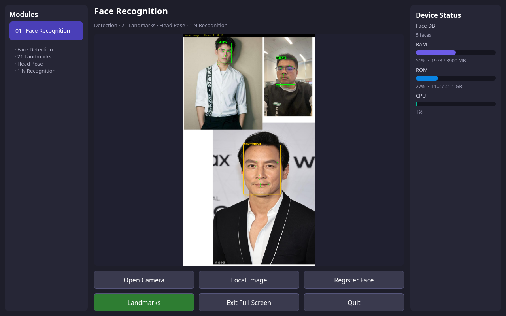

# Face Recognition Demo

English | [简体中文](README.zh.md)

Qt5 desktop demo for Quectel Pi M2 (RK3576, Debian/Ubuntu aarch64). Supports USB-camera and local-image face recognition, landmarks, head pose, and persistent face registration. The English UI displays the face database count and RAM, storage, and CPU usage.



## Requirements

- RK3576 Debian/Ubuntu aarch64 with a graphical desktop session
- C++17 compiler, Make, pkg-config, and Qt5 Widgets development files
- The vendor-provided Face SDK Linux package, kept as `rknn-2.3.2-linux`
- USB camera for live recognition (optional for image mode)

SDK binaries, proprietary libraries, and models are not included. Obtain them through an authorized vendor channel. Do not publish authorization codes, license files, reference face images, or registered biometric data.

## Build

Install missing build dependencies on the device:

```bash
sudo apt update
sudo apt install -y build-essential pkg-config qtbase5-dev
```

Place the SDK platform directory at `$HOME/rknn-2.3.2-linux` and this project at `$HOME/face_project`. Run as the device's ordinary desktop user:

```bash
cd "$HOME/face_project"
sh setup_from_sdk.sh "$HOME/rknn-2.3.2-linux"
sh build.sh
chmod +x run.sh
```

The setup script copies SDK headers, libraries, models, sample images, and reference faces into the project. The demo uses system Qt5 and the SDK's bundled OpenCV world library.

## Run

Provide a valid authorization code, then launch from the device's desktop terminal:

```bash
cd "$HOME/face_project"
FACE_AUTH_CODE='your-authorized-code' ./run.sh
```

Replace `your-authorized-code` with your own code. To select a camera node, append `/dev/videoN`; otherwise the app auto-detects a USB capture node. `v4l2-ctl` is an optional diagnostic tool, not a build requirement.

Controls: **Open Camera**, **Local Image**, **Register Face**, **Landmarks**, **Full Screen**, and **Quit**. Press `F` to toggle full screen; `Esc` or `Q` to quit. Closing the camera clears the display.

## Face Registration

**Register Face** enrolls the largest usable face from the paused camera frame or current image. A face crop with surrounding padding is saved as `facedb/<name>.jpg`; features are extracted again at the next launch. Use a unique name/ID without path characters. Existing JPEGs are not overwritten; use a different name to add another sample.

Reference images in `facedb/` are loaded at startup, using filename stems as names. Use one person per reference image and English names/IDs for the OpenCV overlay. Keep the project writable by the same runtime user. Protect and back up face images. Older feature-only JSON records in `facedb/registered/` remain loadable, but no new JSON records are created; re-register after changing the model when only old feature records are available.

## Authorization

`run.sh` uses `XXXX` as a placeholder, not a valid code. Set `FACE_AUTH_CODE` or replace the placeholder locally; never commit a real code. Defaults are `FACE_MODULE=3` (RK3576), `FACE_APP_ID=145`, and `FACE_LICENSE_FILE=$ROOT/face_license.ini`, where `ROOT` is the project directory. The code, app ID, and `FaceRecognition` resource entitlement must match.

Verify `alg_status=0` and `auth_status=0` in the startup `[init]` line. Model initialization or an open window alone does not confirm authorization. The SDK prefers a valid device-bound local license on subsequent launches, so successful reuse does not prove that a newly supplied code can activate online. Keep the license file between runs and do not copy it to another device.

## Reporting Issues

If you encounter any issues during use, please submit technical inquiries on the [Quectel Official Forum](https://forumschinese.quectel.com/c/quectel-pi/58). Our technical support team will respond promptly. Feel free to submit Issues and Pull Requests to improve this project.