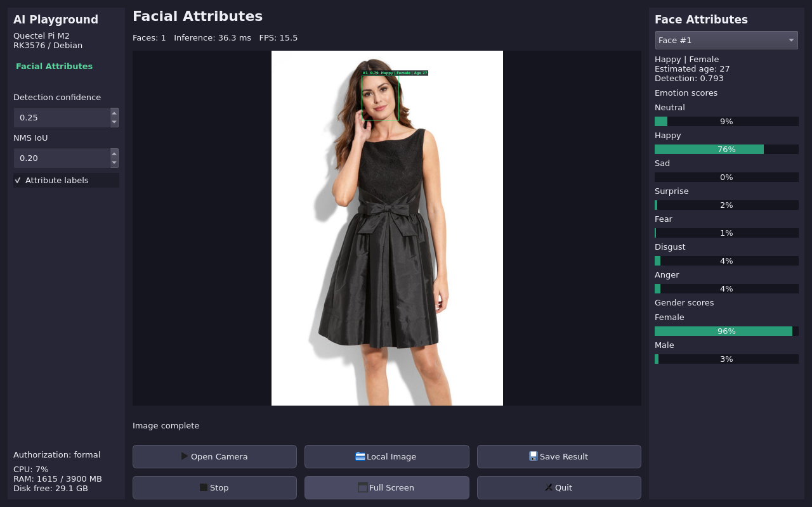

# 人脸属性检测 Demo

面向 Quectel Pi M2（RK3576 / Debian aarch64）的 Qt5 桌面项目。项目结构和三栏界面参考 `face_project`，使用 RK3576 Linux 人脸属性 SDK 的公开接口，不修改 SDK 或授权逻辑。



## 功能

- USB 摄像头实时采集，自动排除 ISP 节点，也可指定设备节点或索引。
- 本地 JPG / PNG / BMP 图片，多人脸检测及逐脸结果选择。
- 人脸框、检测置信度、七类表情及分数、预测年龄、性别及两类分数。
- 检测阈值和 NMS IoU 可调；静态图片自动重新推理。
- 保存同一帧的标注 JPG 和结构化 JSON；无脸图片同样可以导出。
- 推理耗时、处理 FPS、CPU、RAM、磁盘空间、真实 SDK 授权状态。
- 全屏、停止、退出。`F` 切换全屏，`Esc` 退出。

年龄、性别和表情均为模型预测，不是身份或真实心理状态的证明。RK3576 SDK 不提供关键点、识别特征、活体或口罩结果，本项目不展示这些功能。人脸编号只是当前帧顺序，不是跨帧跟踪 ID。

## 目录

```text
facial_attributes_project/
  Makefile
  build.sh
  run.sh
  setup_from_sdk.sh
  src/facial_attributes_cam_demo.cpp
  include/       # setup_from_sdk.sh 生成
  lib/           # SDK + ModelInfer + RKNN + OpenCV world
  models/        # WiderFace + FER 两个 engine
  images/        # SDK 示例 input.jpg
  license/       # SDK 生成的设备授权文件（不要提交）
  outputs/       # 保存的标注 JPG 和 JSON
```

## 板端准备和编译

项目部署目录为 `/home/pi/facial_attributes_project`，SDK 为 `/home/pi/facial_attributes_detection_RK3576`。使用普通用户 `pi` 编译和运行，不使用 root 启动图形程序。

依赖：`g++`、`make`、`pkg-config`、`qtbase5-dev`、`qtwayland5`。OpenCV 使用 SDK 随附的 4.2.0 world 头文件和库，不混用系统 OpenCV。

```sh
cd /home/pi/facial_attributes_project
sh setup_from_sdk.sh /home/pi/facial_attributes_detection_RK3576
sh build.sh
```

默认 SDK 路径可通过 `setup_from_sdk.sh` 第一个参数修改。仅使用 RK3576 Linux 版本，不要混入 RK3568 或 Android 库。

## 授权

算法 module 固定为 RK3576 的 `3`，算法 appid 为 SDK 内置 `147`。引擎层和算法层授权由 SDK 按序处理，demo 不自行绕过校验。

在 `run.sh` 中将 `REPLACE_WITH_ALGORITHM_AUTH_CODE` 替换为 SDK 包提供的测试码或集成方算法授权码即可运行。也可通过环境变量 `FAD_AUTH_CODE` 覆盖脚本中的占位符。不要把真实授权码发到聊天或公开代码仓库；若在 `run.sh` 中填写真实码，分享项目之前应恢复占位符。

首次正式授权需联网，`FAD_LICENSE_FILE` 默认是项目下绝对可写路径 `license/fad_license.txt`。SDK 还会自行管理引擎本机授权件。该 license 是 SDK 自动生成的设备授权文件，不是放算法授权码的地方；不要拷贝其他设备的 license。

SDK 状态 `0` 表示正式授权，`100010` 表示 SDK 放行的离线试用，`100002` 表示试用到期。缺少算法授权码时 SDK 拒绝初始化（`100014`）；不是“空码试用”。仅 SDK 确认离线并允许时才进入试用，demo 不伪造网络状态或延长试用。

SDK 自身可能向标准输出打印授权信息，日志只能保存在本机私有位置，不要公开原始运行日志。授权文件及输出图像都不应提交到仓库。

## 运行

```sh
cd /home/pi/facial_attributes_project
sh run.sh
sh run.sh --camera auto
sh run.sh --camera /dev/video0
sh run.sh --image /home/pi/Pictures/photo.jpg
```

默认展示 SDK 示例图片。左侧设置阈值，中间显示图像和操作按钮，右侧选择当前帧人脸并查看属性分数。图片选择对话框取消时保持当前输入。摄像头断开会停止采集并显示错误，可重新打开。

`run.sh` 自动选择 `pi` 桌面的 Wayland 或 XWayland；需要已登录图形桌面。ADB shell 通常为 root，可这样启动：

```sh
runuser -u pi -- sh -c 'cd /home/pi/facial_attributes_project && sh run.sh'
```

若桌面启动器已安装，也可双击桌面“Facial Attributes”。全屏按钮或 `F` 可适应显示屏。较小显示屏下右侧属性面板可以滚动。

## 结果保存

处理图片或摄像头画面后，点击 **Save Result** 将当前帧及该帧的全部检测结果保存到 `outputs/`：标注 JPG 包含人脸框和属性标签；JSON 包含原图坐标框、检测分数、表情类别及七项 `emotion_scores`、性别类别及两项 `gender_scores`、`age_estimate`、图像尺寸和推理耗时。该 JSON 是本项目的结构化结果格式，不是 SDK 的 LabelMe JSON。

## 报告问题

如在使用过程中遇到问题，欢迎在[移远官方论坛](https://forumschinese.quectel.com/c/quectel-pi/58) 提交技术咨询，我们的技术支持团队将及时为您解答。 欢迎提交Issue和Pull Request来改进此项目。

