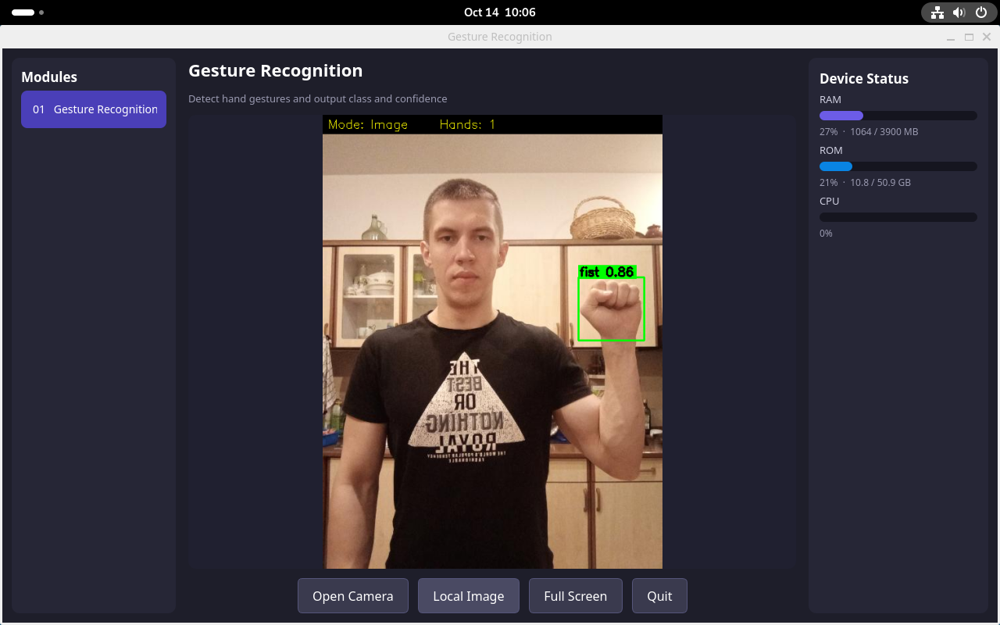

# Gesture Recognition Demo

Qt5 desktop demo for the Quectel Pi M2 (RK3576, Debian/Ubuntu aarch64). It runs the Gesture SDK's hand-detection and gesture-classification pipeline on a USB camera or a selected image. The UI is English and includes RAM, storage, and CPU usage.



## Requirements

- Quectel Pi M2 / RK3576 running Debian or Ubuntu aarch64 with a desktop session
- C++17 compiler, `make`, `pkg-config`, and Qt5 Widgets development files
- The vendor-provided RK3576 Gesture SDK package
- USB camera for live detection (optional for image mode)

The SDK, model files, and proprietary runtime libraries are not included in this repository. Obtain the SDK through the authorized vendor channel. Do not commit SDK binaries, model files, device-bound licenses, or authorization codes to a public repository.

## Build

Place the unpacked SDK platform directory at `$HOME/gesture_RK3576`, then run on the device as the desktop user:

```bash
cd "$HOME/gesture_project"
sh setup_from_sdk.sh "$HOME/gesture_RK3576"
sh build.sh
```

`setup_from_sdk.sh` copies the public header, runtime libraries, models, and sample image into this project. `build.sh` builds `gesture_cam_demo` using the system Qt5 and the SDK's bundled OpenCV library.

Required Debian packages, if missing:

```bash
sudo apt update
sudo apt install -y build-essential pkg-config qtbase5-dev
```

`v4l2-ctl` is optional and is only useful for inspecting camera nodes.

## Run

Start the app from the device's graphical desktop session:

```bash
cd "$HOME/gesture_project"
./run.sh                 # Auto-detect a USB camera
./run.sh /dev/videoN     # Use a specific camera node
```

The UI provides **Open Camera**, **Local Image**, **Full Screen**, and **Quit**. Keyboard shortcuts: `F` toggles full screen; `Esc` or `Q` quits. The camera detector scans V4L2 nodes and selects a USB video-capture device; it does not assume `/dev/video0`.

## Authorization

Set a valid authorization code through `GESTURE_AUTH_CODE` or replace the `XXXX` placeholder in `run.sh`; `XXXX` is not a valid code. `run.sh` also sets `GESTURE_LICENSE_FILE` to the project-local `authorization.lic`. On successful activation, the SDK may create `authorization.lic` and `ql_ans_license.txt` in the project directory. Keep the directory writable by the runtime user and retain these device-bound files between runs; do not copy them to another device or commit them.

The SDK's 30-minute algorithm trial is available only when authorization returns `100010` and the SDK confirms that the authorization server is unreachable. Empty codes and online-invalid codes are rejected by the default strict configuration.

## Reporting Issues

If you encounter any issues during use, please submit technical inquiries on the [Quectel Official Forum](https://forumschinese.quectel.com/c/quectel-pi/58). Our technical support team will respond promptly. Feel free to submit Issues and Pull Requests to improve this project.