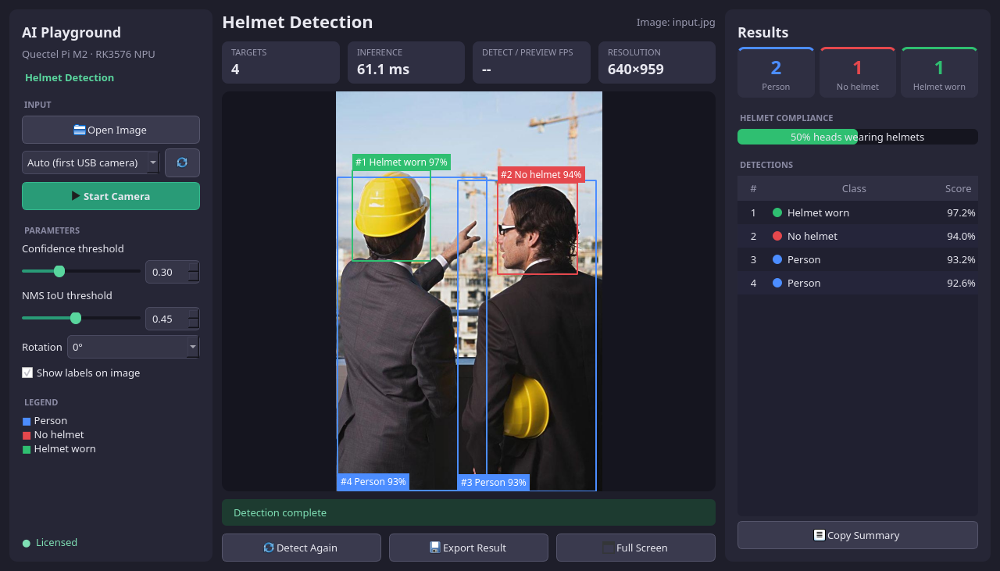

# Helmet Detection Demo

Qt5 desktop demo for the Quectel Pi M2 (RK3576, Debian aarch64). It runs the helmet detection SDK (`HelmetEngine`) to detect persons and heads and classify helmet-wearing status (person / no helmet / helmet worn) on a USB camera, a local video file, or a selected image. Results can be exported as an annotated image, TXT, JSON, and LabelMe JSON.



## Requirements

- Quectel Pi M2 / RK3576 running Debian aarch64 with a desktop session
- C++17 compiler, `make`, `pkg-config`, and Qt5 Widgets development files
- The vendor-provided RK3576 helmet detection SDK package `RK_HD_NPU_v1.4`
- USB camera for live detection (optional for image mode)

The SDK, model files, and proprietary runtime libraries are not included in this repository. Obtain the SDK through the authorized vendor channel. Do not commit SDK binaries, model files, device-bound licenses, or authorization codes to a public repository.

## Build

Place the SDK package at `$HOME/RK_HD_NPU_v1.4`, then run on the device as the desktop user:

```bash
cd "$HOME/helmet_project"
sh setup_from_sdk.sh "$HOME/RK_HD_NPU_v1.4"
sh build.sh
```

`setup_from_sdk.sh` locates the SDK's `rknn-2.3.2-linux` directory and copies the header, runtime libraries, RK3576 model, and sample images into this project. `build.sh` builds `helmet_cam_demo` using the system Qt5 and the SDK's bundled OpenCV library; do not mix it with the system OpenCV.

Required Debian packages, if missing:

```bash
sudo apt update
sudo apt install -y build-essential pkg-config qtbase5-dev
```

## Run

Start the app from the device's graphical desktop session:

```bash
cd "$HOME/helmet_project"
./run.sh                                     # Launch the UI
./run.sh --camera /dev/videoN                # Use a specific camera node
./run.sh --video /path/to/video.mp4          # Detect a local video file
./run.sh --headless --image images/input.jpg # Detect an image without a window
./run.sh --headless --video /path/to/video.mp4 # Detect every video frame without a window; exports the last frame
./run.sh --help                              # Show all options
```

The UI provides **Open Image**, **Open Video**, **Start Camera**, **Export Result**, and **Full Screen**; confidence and NMS thresholds can be adjusted in the UI. Videos (MP4 / AVI / MKV / MOV / WEBM) play at their own frame rate while detection runs on the latest frame; click **Stop Video** to stop, and **Detect Again** replays the last video. Images and videos can also be dragged onto the window. Keyboard shortcuts: `Ctrl+O` opens an image, `Space` starts/stops the camera, `Ctrl+S` exports results, `F11` toggles full screen, and `Esc` leaves full screen. The app scans for USB video-capture nodes and does not assume `/dev/video0`. Results are exported to `outputs/` by default.

## Authorization

Set a valid authorization code through `HELMET_AUTH_CODE` or replace the `REPLACE_WITH_ALGORITHM_AUTH_CODE` placeholder in `run.sh`; the placeholder is not a valid code. The application ID defaults to `145` and can be overridden with `HELMET_APP_ID`; it must match the application the code belongs to. `run.sh` sets `HELMET_LICENSE_FILE` to the project-local `license/helmet_license.ini`, which the SDK creates after the first successful online authorization. Retain this device-bound file between runs; do not copy it to another device or commit it. The first authorization requires network access and a correct system time.

If formal authorization fails, the SDK allows a 1-hour trial and the UI shows `Trial mode`; after the trial ends, inference returns `-10`. A 0-byte license file means the last online authorization failed; delete it and retry with a valid code.

## Reporting Issues

If you encounter any issues during use, please submit technical inquiries on the [Quectel Official Forum](https://forumschinese.quectel.com/c/quectel-pi/58). Our technical support team will respond promptly. Feel free to submit Issues and Pull Requests to improve this project.
