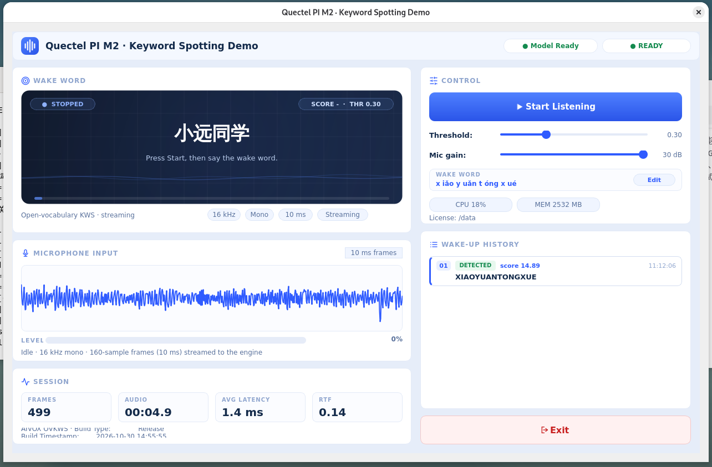

# Keyword Spotting (KWS)

This project is developed based on the **Quectel PI M2 (RK3576)**, integrating the open-vocabulary KWS algorithm package aivox-scr-xiaoyuantongxue-zipformer-960k-zh. It captures mono microphone audio, feeds 10 ms frames to the algorithm in streaming mode, and shows wake-up state, hit score, input level, session statistics and wake-up history. The UI is built with **Qt 6 Widgets and C++ 17**.

The algorithm and the demo logic are decoupled: only kws_engine.cpp touches the algorithm SDK, while audio input and wake-up results are exposed as interfaces, so ASR, TTS or cloud pipelines can be integrated later.



## 🎯 Features
* **Streaming wake-word detection**: 16 kHz / mono / S16_LE audio is split into 160-sample (10 ms) frames and fed to the engine frame by frame
* **Multiple wake words**: one word per line in keywords.txt; all words are shown side by side on the stage
* **Chinese wake-word editor**: click **Edit**, type Chinese words such as 小远同学 (one per line); pinyin is generated from the built-in dictionary
* **Token validation**: converted pinyin tokens are checked against tokens.txt before saving, and invalid words are rejected
* **Hot reload**: after saving, the engine is rebuilt in the background and the previous listening state is restored automatically
* **Hit-only display**: when a single word is detected, the stage shows only that word in green, then restores all words after 2.5 s
* **Wake-up history**: keeps the latest 20 hits with keyword, score and timestamp
* **Session metrics**: frames, processed audio duration, average inference latency and real-time factor (RTF)
* **Live controls**: threshold and microphone gain sliders take effect immediately
* **System status monitoring**: authorization stage, engine version and capture device are printed in the console

## ⚙️ How It Works
1. **Capture**: an ALSA thread reads 160 samples per period, applies software gain (with clipping protection) and reports the input level
2. **Inference**: frames are pushed into a bounded queue (50 frames) and consumed by a worker thread, which calls aivox_ovkws_process for streaming KWS; the GUI thread never blocks on inference
3. **Result**: the SDK callback is forwarded as a queued Qt signal, then the stage, score chip, statistics and history are updated on the GUI thread
4. **Lifecycle**: clicking **Start** creates the engine and resets statistics; clicking **Stop** destroys the engine, clears the queue and stops capture

## 📋 System Requirements
* Hardware: **Quectel PI M2 (RK3576)** + onboard microphone + display
* OS: **Debian 13 (aarch64)**
* Dependencies: **Qt 6 (Widgets)**, **ALSA**, algorithm package **aivox-scr-xiaoyuantongxue-zipformer-960k-zh**
* The algorithm package and its license are **not included** in this repository; download it separately and place it under the project root as aivox-scr-xiaoyuantongxue-zipformer-960k-zh/

## 🚀 Installation & Running
**1. Install the toolchain**
The toolchain is installed in one step via a script; no manual download or compilation is required:
```bash
sudo apt update
sudo bash scripts/setup_toolchain.sh              # install the Qt6/ALSA build chain and runtime dependencies
sudo SKIP_GUI=1 bash scripts/setup_toolchain.sh   # skip GUI dependencies, for command-line debugging only
```

**2. Build**
```bash
mkdir -p build                    # build output directory (CMake / Ninja output)
chmod +x scripts/*.sh
sudo bash scripts/build.sh        # output build/kws_demo
```

**3. Run**
```bash
bash scripts/run.sh               # inject the algorithm path, auth code, model files and launch
```

run.sh prepares the runtime environment automatically:
* sets LD_LIBRARY_PATH to the SDK runtime libraries
* configures the license directory (/data, falling back to ./license)
* binds the board SN to /dev/ttyGS0 (required by the license library, avoids /dev/mem)
* fixes ownership of models/ so the in-app editor can save files
* probes the capture device and falls back to plughw:<card>,<device> when default is unavailable

**Authorization code**: the default code shipped with this demo is used unless overridden:
```bash
export KWS_AUTH_CODE=<your-auth-code>
bash scripts/run.sh
```

**Audio permission** (when capture fails with a permission error): add the current user to the audio group and log in again.
```bash
sudo usermod -aG audio "$USER"
```

## 🎛️ Usage Instructions
1. **Launch**: bash scripts/run.sh, then the window opens with the engine loading in the background
2. **Start listening**: click **Start Listening**; the capture thread starts and the input waveform moves with your voice
3. **Edit wake words**: click **Edit** in the WAKE WORD card, type one Chinese word per line (for example 小远同学), then click **OK**; the engine reloads and listening resumes automatically
4. **Adjust parameters**: move the **Threshold** and **Mic gain** sliders; changes apply immediately
5. **Stop listening**: click **Stop Listening**; capture stops, the engine is released and the statistics keep the last session values
6. **Exit**: click **Exit**

## 🔧 Configuration Parameters
* **Adjustable in the UI**: recognition threshold threshold (default 0.30), microphone gain micGainDb (default 30 dB, range 0-30 dB)
* **Environment variables**: KWS_SDK_ROOT (algorithm package path), KWS_AUTH_CODE (auth code), KWS_LICENSE_DIR (license directory), KWS_CAPTURE_DEV (ALSA capture device), KWS_THRESHOLD, KWS_GAIN_DB, KWS_BOARD_MODULE (default 3 = RK3576), KWS_AT (default 3 = read SN from /dev/ttyGS0), KWS_TOKENS / KWS_KEYWORDS (model files)
* **Wake-word files**: models/tokens.txt is provided by the algorithm package; models/keywords.txt stores one token sequence @display text per line; models/pinyin.txt is the bundled Chinese-to-pinyin dictionary (generated from mozillazg/pinyin-data and Unicode Unihan)

## 📁 Project Structure
```
kws_project/                                        # project root
├── CMakeLists.txt                                  # build configuration
├── README.md
├── README_zh.md
├── aivox-scr-xiaoyuantongxue-zipformer-960k-zh/    # algorithm package (download separately)
├── assets/
│   └── kws.png                                     # UI preview
├── models/
│   ├── tokens.txt                         # model vocabulary 
│   ├── keywords.txt                       # wake words, one per line
│   └── pinyin.txt                         # Chinese-to-pinyin dictionary
├── src/
│   ├── main.cpp                           # entry point
│   ├── audio_capture.*                    # ALSA capture
│   ├── kws_engine.*                       # algorithm wrapper 
│   ├── kws_pipeline.*                     # capture -> queue -> worker thread -> GUI pipeline
│   ├── kws_interfaces.h                   # abstract interfaces
│   ├── kws_types.h                        # shared data structures
│   └── main_window.*                      # UI
└── scripts/
    ├── setup_toolchain.sh                 # toolchain installation
    ├── build.sh                           # build
    └── run.sh                             # run
```

## ❓ FAQ
* **Startup stops at the authorization stage**: the license library reads the board SN from /dev/ttyGS0; if the node is the real serial port, the read blocks. Re-create the bind mount as printed by run.sh, or run the manual commands it suggests
* **permission denied when saving wake words**: models/ is owned by root; run sudo chown -R <current-user>:<current-user> models or re-run run.sh, which fixes ownership automatically
* **No waveform and arecord reports "Host is down"**: the default PCM points to PulseAudio, which root cannot reach; use KWS_CAPTURE_DEV=plughw:0,0 or run as the desktop user
* **Engine fails to start after editing wake words**: some converted tokens are not in tokens.txt; check the preview in the editor and choose another word
* **Wake words are hard or too easy to trigger**: tune the threshold (0.20-0.40) and mic gain (20-30 dB, avoid clipping), or use per-word #threshold with the global threshold set to 0
* **Qt reports a missing xcb platform plugin**: install libxcb-cursor0
* **Initialization or authorization failure**: confirm the network is reachable (the first authorization requires the license server) and the SN node contains the correct value

## 📬 Report Issues
If you encounter any problem while using this project, feel free to submit a technical inquiry on the Quectel official forum, and our technical support team will respond promptly. Issues and Pull Requests are welcome to improve this project.
