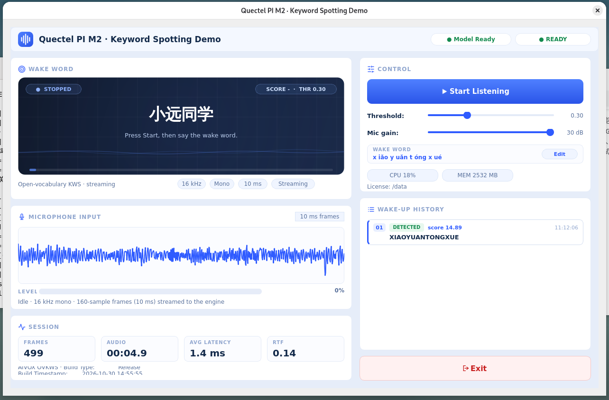

# 关键词唤醒（KWS）

本项目基于 **Quectel PI M2（RK3576）** 开发，集成开放词表关键词唤醒算法包 aivox-scr-xiaoyuantongxue-zipformer-960k-zh。程序采集单声道麦克风音频，以流式方式按帧送入算法，界面展示唤醒状态、命中分数、实时电平、会话统计与唤醒历史。界面基于 **Qt 6 Widgets 与 C++ 17** 构建。

工程将**算法**与**演示逻辑**分开：只有 kws_engine.cpp 接触算法 SDK，音频输入与唤醒结果均以接口形式暴露，后续可接入 ASR、TTS 或云端链路。



## 🎯 功能特点
* **流式唤醒识别**：16 kHz / 单声道 / S16_LE 音频按 160 采样（10 ms）分帧，逐帧送入引擎
* **多唤醒词支持**：keywords.txt 中一行一个唤醒词，舞台并列展示全部唤醒词
* **中文唤醒词编辑**：点击 **Edit** 直接输入中文（一行一个，如 小远同学），程序通过内置词典自动转拼音
* **Token 校验**：转换后的 token 会与 tokens.txt 比对，不在词表中的词直接拒绝保存
* **热重建引擎**：保存后自动在后台重建引擎，并恢复之前的监听状态
* **命中单词显示**：触发某个词时舞台只显示该词并绿色高亮，2.5 s 后恢复全部唤醒词
* **唤醒历史**：保留最近 20 条命中记录，含唤醒词、分数与时间
* **会话统计**：帧数、已处理音频时长、平均推理耗时、实时率（RTF）
* **实时调节**：识别阈值与麦克风增益滑块改动立即生效
* **系统状态监控**：控制台输出授权阶段、引擎版本与采集设备信息

## ⚙️ 工作原理
1. **采集**：ALSA 线程按周期读取 160 采样，做软件增益（带削波保护）并上报输入电平
2. **推理**：帧进入有界队列（50 帧），由工作线程消费并调用 aivox_ovkws_process 做流式识别；GUI 线程不阻塞在推理上
3. **显示**：SDK 回调通过 Qt queued signal 转发，在 GUI 线程更新舞台、分数、统计与历史
4. **生命周期**：点击 **Start** 创建引擎并重置统计；点击 **Stop** 销毁引擎、清空队列并停止采集

## 📋 系统要求
* 硬件：**Quectel PI M2（RK3576）** + 板载麦克风 + 显示器
* 系统：**Debian 13（aarch64）**
* 依赖：**Qt 6（Widgets）**、**ALSA**、算法包 **aivox-scr-xiaoyuantongxue-zipformer-960k-zh**
* 本仓库**不包含**算法包及其授权文件，请自行下载后放到工程根目录下的 aivox-scr-xiaoyuantongxue-zipformer-960k-zh/

## 🚀 安装与运行
**1. 安装工具链**
工具链通过脚本一键安装，无需手动下载编译：
```bash
sudo apt update
sudo bash scripts/setup_toolchain.sh              # 安装 Qt6/ALSA 编译链及运行期依赖
sudo SKIP_GUI=1 bash scripts/setup_toolchain.sh   # 跳过 GUI 依赖，仅命令行调试
```

**2. 构建**
```bash
mkdir -p build                    # 构建产物目录（CMake / Ninja 输出）
chmod +x scripts/*.sh
sudo bash scripts/build.sh        # 产物 build/kws_demo
```

**3. 运行**
```bash
bash scripts/run.sh               # 注入算法路径、授权码、模型文件并启动
```

run.sh 会自动完成运行环境准备：
* 设置 LD_LIBRARY_PATH 指向 SDK 运行库
* 配置 license 目录（/data，不可写时回退 ./license）
* 将板端 SN 绑定到 /dev/ttyGS0（授权库读取设备 ID 所需，绕开 /dev/mem）
* 修正 models/ 属主，保证界面内编辑能保存文件
* 探测采集设备，default 不可用时自动回退 plughw:<card>,<device>

**授权码**：默认使用本 Demo 配套的授权码，也可自行覆盖：
```bash
export KWS_AUTH_CODE=<您的授权码>
bash scripts/run.sh
```

**音频权限**（采集报权限不足时）：将当前用户加入 audio 组并重新登录。
```bash
sudo usermod -aG audio "$USER"
```

## 🎛️ 使用说明
1. **启动**：bash scripts/run.sh，窗口打开后引擎在后台加载
2. **开始监听**：点击 **Start Listening**，采集线程启动，输入波形随声音抖动
3. **编辑唤醒词**：在 WAKE WORD 卡片点击 **Edit**，一行一个输入中文（如 小远同学），点击 **OK**；引擎自动重建并恢复监听
4. **调整参数**：拖动 **Threshold** 与 **Mic gain** 滑块，改动立即生效
5. **停止监听**：点击 **Stop Listening**，停止采集、释放引擎，统计保留上一次会话数值
6. **退出**：点击 **Exit**

## 🔧 配置参数
* **界面内可调**：识别阈值 threshold（默认 0.30）、麦克风增益 micGainDb（默认 30 dB，范围 0-30 dB）
* **环境变量**：KWS_SDK_ROOT（算法包路径）、KWS_AUTH_CODE（授权码）、KWS_LICENSE_DIR（license 目录）、KWS_CAPTURE_DEV（ALSA 采集设备）、KWS_THRESHOLD、KWS_GAIN_DB、KWS_BOARD_MODULE（默认 3 = RK3576）、KWS_AT（默认 3 = 从 /dev/ttyGS0 读 SN）、KWS_TOKENS / KWS_KEYWORDS（模型文件）
* **唤醒词文件**：models/tokens.txt 由算法包提供；models/keywords.txt 每行保存 token 序列 @显示文本；models/pinyin.txt 为内置汉字转拼音词典（由 mozillazg/pinyin-data 与 Unicode Unihan 生成）

## 📁 项目结构
```
kws_demo/                                           # 项目根目录
├── CMakeLists.txt                                  # 构建配置
├── README.md
├── README_zh.md
├── aivox-scr-xiaoyuantongxue-zipformer-960k-zh/    # 算法包
├── assets/
│   └── kws.png                                     # UI 预览图
├── models/
│   ├── tokens.txt                                  # 模型词表（来自算法包）
│   ├── keywords.txt                                # 唤醒词，一行一个
│   └── pinyin.txt                                  # 汉字转拼音词典
├── src/
│   ├── main.cpp                                    # 入口
│   ├── audio_capture.*                             # ALSA 采集
│   ├── kws_engine.*                                # 算法封装（唯一接入算法包模块）
│   ├── kws_pipeline.*                              # 采集 -> 队列 -> 工作线程 -> GUI 管线
│   ├── kws_interfaces.h                            # 抽象接口（音频源、识别器、结果 sink）
│   ├── kws_types.h                                 # 公共数据结构
│   └── main_window.*                               # 界面
└── scripts/
    ├── setup_toolchain.sh                          # 工具链安装
    ├── build.sh                                    # 编译
    └── run.sh                                      # 运行
```

## ❓ 常见问题
* **启动卡在授权阶段**：授权库从 /dev/ttyGS0 读取板端 SN，若该节点是真实串口会阻塞读取。按 run.sh 打印的命令重建 bind mount，或直接执行其提示的手动命令
* **保存唤醒词报 permission denied**：models/ 属主为 root。执行 sudo chown -R <当前用户>:<当前用户> models，或重新运行 run.sh（会自动修正属主）
* **波形不动且 arecord 报 "Host is down"**：default PCM 指向 PulseAudio，root 无法连接。使用 KWS_CAPTURE_DEV=plughw:0,0，或以桌面用户身份运行
* **修改唤醒词后引擎启动失败**：转换出的 token 不在 tokens.txt 中。查看编辑器中的预览提示，更换唤醒词
* **唤醒词难触发或过于灵敏**：调整阈值（0.20-0.40）与增益（20-30 dB，注意削波）；也可将全局阈值设为 0，改用每词 #threshold
* **Qt 提示缺少 xcb 平台插件**：安装 libxcb-cursor0
* **初始化 / 授权失败**：确认网络可达（首次授权需要连接授权服务器），且 SN 节点内容正确

## 📬 报告问题
如在使用过程中遇到问题，欢迎在移远官方论坛提交技术咨询，我们的技术支持团队将及时为您解答。欢迎提交 Issue 和 Pull Request 来改进此项目。
