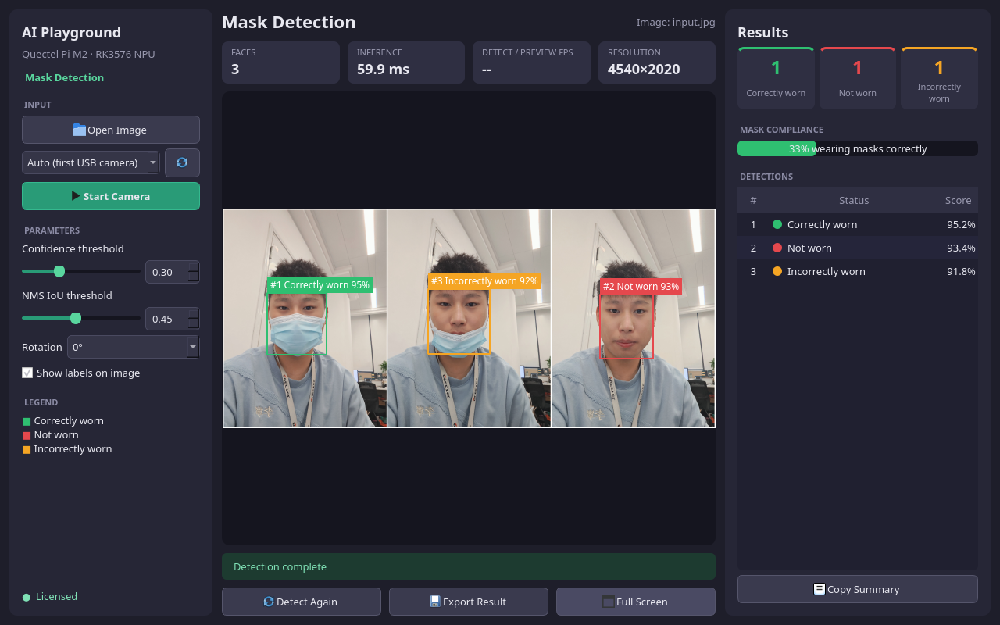

# 口罩检测 Demo

面向 Quectel Pi M2（RK3576、Debian aarch64）的 Qt5 桌面 Demo，调用口罩检测 SDK（`MaskEngine`）检测人脸并判断口罩佩戴状态（正确佩戴 / 未佩戴 / 不正确佩戴）。支持 USB 摄像头实时检测与本地图片检测，可导出标注图、TXT、JSON 和 LabelMe JSON。



## 环境要求

- RK3576 Debian aarch64，带桌面会话
- C++17、Make、pkg-config、Qt5 Widgets 开发包
- RK3576 口罩检测 SDK 包 `RK_MD_NPU_v1.4`
- USB 摄像头（仅实时检测需要）

SDK、模型及专有运行库不包含在本仓库中，请通过授权渠道获取。不要将 SDK 二进制、模型、设备授权文件或授权码提交到公开仓库。

## 编译

将 SDK 包放在设备用户目录 `$HOME/RK_MD_NPU_v1.4`，然后在设备桌面终端执行：

```bash
cd "$HOME/maskdet_project"
sh setup_from_sdk.sh "$HOME/RK_MD_NPU_v1.4"
sh build.sh
```

`setup_from_sdk.sh` 会自动定位 SDK 中的 `rknn-2.3.2-linux` 目录，并复制头文件、运行库、RK3576 模型和示例图片。程序使用 SDK 自带的 OpenCV，不要混用系统 OpenCV。

缺少编译依赖时安装：

```bash
sudo apt update
sudo apt install -y build-essential pkg-config qtbase5-dev
```

## 运行

在设备桌面会话启动：

```bash
cd "$HOME/maskdet_project"
./run.sh                                     # 启动界面
./run.sh --camera /dev/videoN                # 指定摄像头节点
./run.sh --headless --image images/input.jpg # 无窗口检测图片
./run.sh --help                              # 查看全部参数
```

界面按钮为 **Open Image**、**Start Camera**、**Export Result** 和 **Full Screen**，置信度与 NMS 阈值可在界面中调整。快捷键：`Ctrl+O` 打开图片，`Space` 开始/停止摄像头，`Ctrl+S` 导出结果，`F11` 切换全屏，`Esc` 退出全屏。程序自动扫描 USB 视频采集节点，不假设摄像头是 `/dev/video0`。结果默认导出到 `outputs/`。

## 授权

请通过环境变量 `MASK_AUTH_CODE` 提供有效授权码，或将 `run.sh` 中的 `REPLACE_WITH_ALGORITHM_AUTH_CODE` 替换为有效码，该值只是占位符，不能用于授权。应用 ID 默认 `147`，可用 `MASK_APP_ID` 覆盖。脚本将 `MASK_LICENSE_FILE` 指向工程目录下的 `license/mask_license.ini`，首次在线授权成功后由 SDK 生成；请保留该设备绑定文件，不要复制到其他设备或提交到仓库。首次授权需要网络和正确的系统时间。

正式授权失败时 SDK 提供 1 小时试用，界面会显示 `Trial mode`；试用结束后推理返回 `-10`。0 字节的许可证文件表示上次在线授权失败，删除后用正确授权码重试。

## 报告问题

如在使用过程中遇到问题，欢迎在[移远官方论坛](https://forumschinese.quectel.com/c/quectel-pi/58) 提交技术咨询，我们的技术支持团队将及时为您解答。 欢迎提交Issue和Pull Request来改进此项目。
