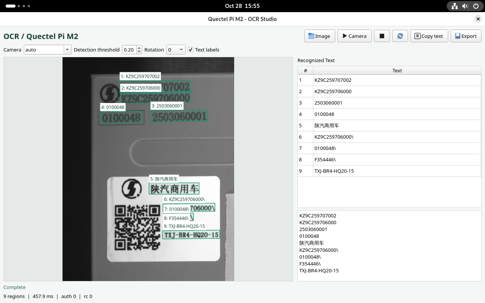

# OCR Text Recognition Demo

Qt5 desktop demo for the Quectel Pi M2 (RK3576, Debian aarch64). It runs the OCR SDK (DeepOCR) text detection and recognition pipeline on a USB camera or a selected image. Results can be exported as an annotated image, TXT, JSON, and LabelMe JSON.



## Requirements

- Quectel Pi M2 / RK3576 running Debian aarch64 with a desktop session
- C++17 compiler, `make`, `pkg-config`, Qt5 Widgets development files, and Noto CJK fonts
- The vendor-provided RK3576 OCR SDK package `RK_OCR_NPU_1.2`
- USB camera for live recognition (optional for image mode)

The SDK, model files, and proprietary runtime libraries are not included in this repository. Obtain the SDK through the authorized vendor channel. Do not commit SDK binaries, model files, device-bound licenses, or authorization codes to a public repository.

## Build

Place the SDK package at `$HOME/RK_OCR_NPU_1.2`, then run on the device as the desktop user:

```bash
cd "$HOME/ocr_project"
sh setup_from_sdk.sh "$HOME/RK_OCR_NPU_1.2"
sh build.sh
```

`setup_from_sdk.sh` locates the SDK's RK3576 Linux `deep_ocr` directory and copies the header, runtime libraries, models, and sample images into this project. `build.sh` builds `ocr_cam_demo` using the system Qt5 and the SDK's bundled OpenCV library; do not mix it with the system OpenCV.

Required Debian packages, if missing:

```bash
sudo apt update
sudo apt install -y build-essential pkg-config qtbase5-dev fonts-noto-cjk
```

## Run

Start the app from the device's graphical desktop session:

```bash
cd "$HOME/ocr_project"
./run.sh                                     # Launch the UI
./run.sh --camera /dev/videoN                # Use a specific camera node
./run.sh --headless --image images/111.png   # Recognize an image without a window
./run.sh --headless --help                   # Show all options
```

The UI provides **Image**, **Camera**, **Copy text**, and **Export**; the detection threshold and rotation can be adjusted in the UI. The app scans for USB video-capture nodes and does not assume `/dev/video0`. Results are exported to `outputs/` by default.

## Authorization

Set a valid authorization code through `OCR_AUTH_CODE` or replace the `REPLACE_WITH_ALGORITHM_AUTH_CODE` placeholder in `run.sh`; the placeholder is not a valid code. `run.sh` sets `OCR_LICENSE_FILE` to the project-local `license/ocr.lic`, which the SDK creates after the first successful authorization. Retain this device-bound file between runs; do not copy it to another device or commit it. The first authorization requires network access and a correct system time.

## Reporting Issues

If you encounter any issues during use, please submit technical inquiries on the [Quectel Official Forum](https://forumschinese.quectel.com/c/quectel-pi/58). Our technical support team will respond promptly. Feel free to submit Issues and Pull Requests to improve this project.
