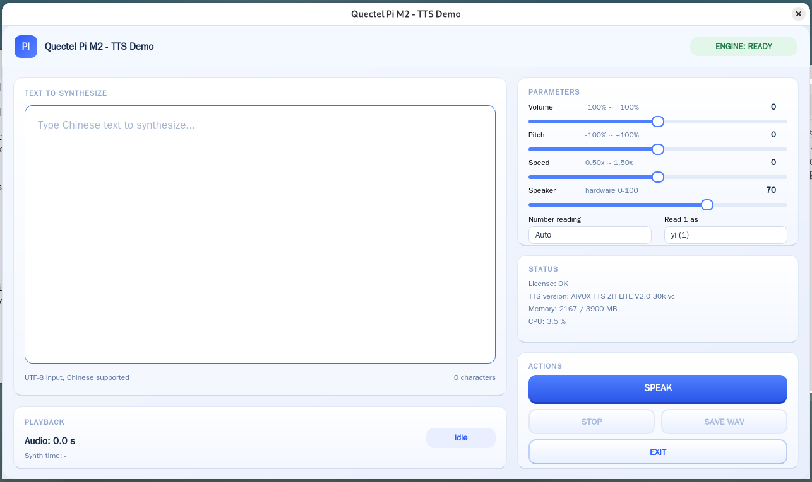

# TTS Speech Synthesis

English | [中文](README_zh.md)

This project is developed based on the **Quectel PI M2 (RK3576)**, integrating the algorithm package `AIVOX-TTS-ZH-LITE-V2.0-30k-vc` to synthesize Chinese text into speech in real time and play it through the onboard sound card. The UI is built with **Qt 6 Widgets and C++ 17**, featuring a fixed 1280×720 card-based layout with real-time parameter adjustment, instant stop and WAV export.



## 🎯 Features

* **Chinese speech synthesis**: enter multi-line text and click SPEAK to synthesize and play immediately
* **Streaming output**: the algorithm returns PCM in 30 ms chunks (about 960 bytes), so playback starts while synthesis is still running
* **Long-text segmentation**: splits text by sentence-ending punctuation and synthesizes sentence by sentence, avoiding algorithm package issues with very long text or special symbols
* **Instant stop**: STOP clears the playback queue and drops the sound card buffer for millisecond silence, and interrupts the synthesis of remaining sentences
* **Real-time parameters**: volume, pitch and speed sliders; number reading mode (Auto / Digit / Value); how the digit "1" is read (yi / yao)
* **Speaker volume**: the Speaker slider drives the hardware mixer (`DACL/DACR`), independent of the algorithm-side volume
* **Synthesis time**: the result card shows the actual synthesis duration (`Synth time: x.xx s`)
* **WAV export**: SAVE WAV writes 16 kHz / mono / 16-bit audio
* **System status monitoring**: license result, TTS version, memory usage and CPU utilization in real time

## ⚙️ How It Works

1. **Input and splitting**: the text is sanitized (control characters folded) and split by `。！？；` (over-long sentences are further split by commas)
2. **Synthesis**: each sentence is passed to `aivox_tts_TextPut`, and the algorithm returns PCM in 30 ms chunks (16 kHz / mono / S16_LE)
3. **Resampling and playback**: chunks are resampled to the hardware's real rate and pushed into the playback queue; an independent playback thread keeps writing to the sound card. The GUI only receives Qt queued signals, so it never blocks on authorization or synthesis

## 📋 System Requirements

* Hardware: **Quectel PI M2 (RK3576)** + onboard speaker or 3.5 mm headphone output
* OS: **Debian 13 (aarch64)**
* Dependencies: **Qt 6 (Widgets)**, **ALSA (libasound2)**, algorithm package **AIVOX-TTS-ZH-LITE**
* License: a TTS auth code (func=6, RK3576) must be obtained from Quectel; the first activation requires network access on the board

## 🚀 Installation & Running

**1. Install the toolchain**

```bash
sudo apt update
sudo bash scripts/setup_toolchain.sh              # install the Qt6 / ALSA build chain and runtime dependencies
sudo SKIP_GUI=1 bash scripts/setup_toolchain.sh   # skip GUI dependencies, for command-line debugging only
```

**2. Build**

```bash
chmod +x scripts/*.sh
bash scripts/build.sh                             # output build/tts_qt_demo; -j1 by default for low-memory boards
```

**3. Run**

```bash
export TTS_AUTH_CODE=<your-auth-code>             # only needed for the first online activation
bash scripts/run.sh
```

After the first successful activation the license is stored in `/data/aivox_tts_license.txt`, and later runs do not need the auth code.

For headless environments, specify the Qt platform backend:

```bash
QT_QPA_PLATFORM=eglfs bash scripts/run.sh
QT_QPA_PLATFORM=linuxfb:fb=/dev/fb0 bash scripts/run.sh
```

## 🎛️ Usage Instructions

1. **Launch**: `bash scripts/run.sh`; the window is fixed at 1280×720 and the engine authorizes and initializes in the background
2. **Enter text**: type Chinese content in the `Text to Synthesize` box
3. **Synthesize and play**: click **SPEAK**; the state goes Synthesizing → Playing → Done
4. **Stop**: click **STOP** during playback for instant silence and to abort the remaining sentences
5. **Adjust parameters**: drag Volume / Pitch / Speed in the `Parameters` card, or switch Read mode and Read 1 as; changes apply to the next synthesis
6. **Save and exit**: click **SAVE WAV** to export audio, and **EXIT** to quit

## 🔧 Configuration Parameters

**Adjustable in the UI (Parameters card)**

| Parameter | Description | Range / Default |
| --- | --- | --- |
| Volume | Algorithm volume | -100% ~ +100%, default 0 (reference) |
| Pitch | Pitch | -100% ~ +100%, default 0 |
| Speed | Speech rate | 0.50x ~ 1.50x, default 1.00x |
| Read mode | Number reading | Auto / Digit / Value |
| Read 1 as | Reading of the digit "1" | yi / yao |

**Environment variables**

| Name | Description | Default |
| --- | --- | --- |
| `TTS_AUTH_CODE` | Auth code for online activation | empty (skip activation, local verification only) |
| `TTS_LICENSE_DIR` | Directory holding the license file | `/data` |
| `TTS_AUDIO_DEV` | ALSA playback device | auto probe `plughw:0,0` → `default` → `hw:0,0` |
| `TTS_AUDIO_HW_RATE` | Real hardware playback rate; 16k PCM is resampled to it | `32000` (measured on PI M2) |
| `AIVOX_TTS_HOME` | Algorithm package root | `./AIVOX-TTS-ZH-LITE-V2.0-30k-vc` |
| `BUILD_JOBS` | Build parallelism | `1` (single process by default on low-memory boards) |

**Command-line arguments**

* `--text=<text>`: pre-fill the text box at startup
* `--audio-device=<device>`: ALSA playback device, takes precedence over `TTS_AUDIO_DEV`

## 📁 Project Structure

```
tts_project/                        # project root
├── CMakeLists.txt                  # build configuration
├── README.md                       # English documentation
├── README_zh.md                    # Chinese documentation
├── assets/
│   └── tts.png                     # UI preview image
├── src/
│   ├── main.cpp                    # entry point and wiring (text, ALSA device options)
│   ├── main_window.*               # UI and synthesis worker thread
│   ├── audio_output.*              # audio output (IAudioSink + AlsaAudioSink, resampling and mixer volume)
│   └── tts_engine.*                # algorithm wrapper (the only module that includes AIVOX headers)
├── scripts/
│   ├── setup_toolchain.sh          # toolchain installation
│   ├── build.sh                    # build
│   └── run.sh                      # run (sets LD_LIBRARY_PATH and license environment)
└── AIVOX-TTS-ZH-LITE-V2.0-30k-vc/  # algorithm package (include / lib / resource)
```

## ❓ FAQ

* **Authorization failure (100010)**: the board cannot resolve the license server hostname; check `nameserver` in `/etc/resolv.conf`
* **Authorization failure (100012)**: `/data/aivox_tts_license.txt` is missing; make sure the directory is writable and the first activation succeeded
* **Hearing the "please authorize" prompt**: authorization did not pass; rely on the License field in the UI and the `licenses_verify` return code
* **Speech too fast / too slow**: the 16 kHz reported by ALSA may only be nominal. Measure the real factor with a 10-second known audio file (`time aplay -D plughw:0,0 sine10.wav`) and set `TTS_AUDIO_HW_RATE` to `16000 × factor` (PI M2 consumes at 32 kHz, hence the default `32000`)
* **Speaker slider has no effect**: the startup log `[mixer] volume control:` shows the selected control; if it says `no playback volume control`, check `amixer -c 0 scontrols` and report the valid control name
* **No sound**: first confirm the system layer works with `aplay -D plughw:0,0 some.wav`, then specify `TTS_AUDIO_DEV`
* **Initialization hangs**: while reading the SN via AT commands the license library accesses `/dev/ttyGS0`; if that node has no response it blocks. Bind a file containing the 16-character SN to that node with `mount --bind`

## 📬 Report Issues

If you encounter any problem while using this project, feel free to submit a technical inquiry on the Quectel official forum, and our technical support team will respond promptly. Issues and Pull Requests are welcome to improve this project.
