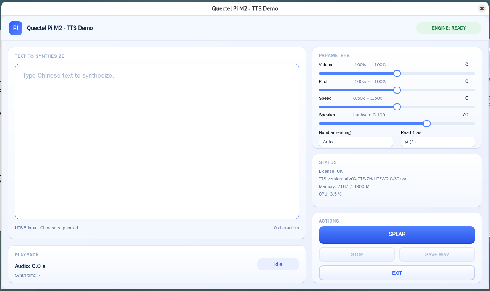

# TTS 语音合成

[English](README.md) | 中文

本项目基于 **Quectel PI M2（RK3576）** 开发，集成算法包 `AIVOX-TTS-ZH-LITE-V2.0-30k-vc`，把中文文本实时合成为语音并通过板载声卡播放。界面基于 **Qt 6 Widgets 与 C++ 17** 构建，采用 1280×720 固定外框的卡片式布局，支持参数实时调节、随时停止与 WAV 导出。



## 🎯 功能特点

* **中文语音合成**：多行文本框输入，点击 SPEAK 即合成并直接播放
* **流式输出**：算法按 30 ms 一块（约 960 字节）回调 PCM，边合成边播放，无需等整段算完
* **长文本分段**：按句末标点切分逐句合成，规避算法包对超长文本/特殊符号的兼容问题
* **随时停止**：STOP 立即清空播放队列并丢弃声卡缓冲，毫秒级静音，并中断后续句子的合成
* **参数实时可调**：音量、音调、语速滑杆，数字读法（Auto / 逐位 / 按数值），数字“1”读法（yi / yao）
* **喇叭音量**：Speaker 滑杆直接调节硬件混音器（`DACL/DACR`），与算法侧音量独立
* **合成耗时**：结果卡显示本次合成实际用时（`Synth time: x.xx s`）
* **WAV 导出**：SAVE WAV 保存 16 kHz / 单声道 / 16 bit 音频
* **系统状态监控**：实时显示授权结果、TTS 版本、内存占用与 CPU 占用

## ⚙️ 工作原理

1. **输入与切分**：文本框内容先清洗控制字符，再按 `。！？；` 切句（单句过长时按逗号再切）
2. **合成**：逐句调用 `aivox_tts_TextPut`，算法以 30 ms 一块回调 PCM（16 kHz / 单声道 / S16_LE）
3. **重采样与播放**：回调内按硬件实际采样率重采样后压入播放队列，独立播放线程持续写声卡；GUI 只通过 Qt 队列信号更新状态，不会因合成或授权而卡死

## 📋 系统要求

* 硬件：**Quectel PI M2（RK3576）** + 板载喇叭或 3.5 mm 耳机输出
* 系统：**Debian 13（aarch64）**
* 依赖：**Qt 6（Widgets）**、**ALSA（libasound2）**、算法包 **AIVOX-TTS-ZH-LITE**

## 🚀 安装与运行

**1. 安装工具链**

```bash
sudo apt update
sudo bash scripts/setup_toolchain.sh              # 安装 Qt6 / ALSA 编译链与运行期依赖
sudo SKIP_GUI=1 bash scripts/setup_toolchain.sh   # 跳过 GUI 依赖，仅命令行调试
```

**2. 构建**

```bash
chmod +x scripts/*.sh
bash scripts/build.sh                             # 产物 build/tts_qt_demo；低内存板卡默认 -j1
```

**3. 运行**

```bash
export TTS_AUTH_CODE=<您的授权码>                 # 仅首次在线激活需要
bash scripts/run.sh
```

首次激活成功后 license 落盘到 `/data/aivox_tts_license.txt`，之后不设授权码也可直接运行。

无桌面环境时可指定 Qt 平台后端：

```bash
QT_QPA_PLATFORM=eglfs bash scripts/run.sh
QT_QPA_PLATFORM=linuxfb:fb=/dev/fb0 bash scripts/run.sh
```

## 🎛️ 使用说明

1. **启动**：`bash scripts/run.sh`，窗口固定 1280×720，引擎在后台完成授权与初始化
2. **输入文本**：在 `Text to Synthesize` 文本框输入中文内容
3. **合成播放**：点击 **SPEAK**，状态依次为 Synthesizing → Playing → Done
4. **停止**：播放中点击 **STOP**，立即静音并中断剩余句子的合成
5. **调整参数**：在 `Parameters` 卡拖动 Volume / Pitch / Speed，或切换 Read mode、Read 1 as，下一次合成生效
6. **保存与退出**：点击 **SAVE WAV** 导出音频，点击 **EXIT** 退出

## 🔧 配置参数

**界面内可调（Parameters 卡）**

| 参数 | 说明 | 范围 / 默认 |
| --- | --- | --- |
| Volume | 算法音量 | -100% ~ +100%，默认 0（基准） |
| Pitch | 音调 | -100% ~ +100%，默认 0 |
| Speed | 语速 | 0.50x ~ 1.50x，默认 1.00x |
| Read mode | 数字读法 | Auto / 逐位 / 按数值 |
| Read 1 as | 数字“1”读作 | yi / yao |

**环境变量**

| 名称 | 说明 | 默认 |
| --- | --- | --- |
| `TTS_AUTH_CODE` | 在线激活授权码 | 空（跳过在线激活，仅本地校验） |
| `TTS_LICENSE_DIR` | license 文件存放目录 | `/data` |
| `TTS_AUDIO_DEV` | ALSA 播放设备名 | 自动探测 `plughw:0,0` → `default` → `hw:0,0` |
| `TTS_AUDIO_HW_RATE` | 硬件实际播放率，按此值重采样 16k PCM | `32000`（Pi M2 实测正常语速） |
| `AIVOX_TTS_HOME` | 算法包根目录 | `./AIVOX-TTS-ZH-LITE-V2.0-30k-vc` |
| `BUILD_JOBS` | 编译并行度 | `1`（低内存板卡默认单进程） |

**命令行参数**

* `--text=<文本>`：启动时预填文本
* `--audio-device=<设备>`：ALSA 播放设备，优先级高于 `TTS_AUDIO_DEV`

## 📁 项目结构

```
tts_qt_demo/                        # 项目根目录
├── CMakeLists.txt                  # 构建配置
├── README.md                       # 英文说明
├── README_zh.md                    # 中文说明
├── assets/
│   └── tts.png                     # 界面预览图
├── src/
│   ├── main.cpp                    # 入口与组装（文本、ALSA 设备参数）
│   ├── main_window.*               # 界面与合成工作线程
│   ├── audio_output.*              # 音频输出（IAudioSink + AlsaAudioSink，含重采样与混音器音量）
│   └── tts_engine.*                # 算法接入（唯一包含 AIVOX 头文件的模块）
├── scripts/
│   ├── setup_toolchain.sh          # 工具链安装
│   ├── build.sh                    # 编译
│   └── run.sh                      # 运行（组装 LD_LIBRARY_PATH 与授权环境变量）
└── AIVOX-TTS-ZH-LITE-V2.0-30k-vc/  # 算法包
```

## ❓ 常见问题

* **授权失败（100010）**：板端无法解析授权服务器域名，检查 `/etc/resolv.conf` 中的 `nameserver`
* **授权失败（100012）**：`/data` 下没有 `aivox_tts_license.txt`，确认目录可写、首次激活已成功
* **听到“请授权后使用”提示语**：说明授权未通过，以界面 License 一栏与 `licenses_verify` 返回码为准
* **语速偏快 / 偏慢**：ALSA 报告的 16 kHz 可能只是名义值。用 10 秒已知音频 `time aplay -D plughw:0,0 sine10.wav` 测出真实倍数，把 `TTS_AUDIO_HW_RATE` 设为 `16000 × 倍数`（Pi M2 实测按 32 kHz 消费，故默认 32000）
* **Speaker 滑杆无效**：启动日志 `[mixer] volume control:` 会打印实际控件；若为 `no playback volume control`，用 `amixer -c 0 scontrols` 查看并把有效控件名反馈
* **没有声音**：先用 `aplay -D plughw:0,0 some.wav` 确认系统层可出声，再指定 `TTS_AUDIO_DEV`
* **初始化长时间无响应**：AT 取 SN 时授权库会读取 `/dev/ttyGS0`，若该节点无应答会阻塞，可用 `mount --bind` 将含 16 字符 SN 的文件绑定到该节点

## 📬 报告问题

如在使用过程中遇到问题，欢迎在移远官方论坛提交技术咨询，我们的技术支持团队将及时为您解答。欢迎提交 Issue 和 Pull Request 来改进此项目。
